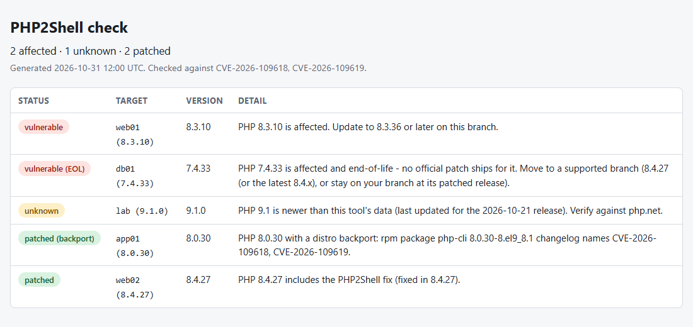

# php2shell-check

[](https://github.com/SirjanSingh/php2shell-check/actions/workflows/ci.yml)
[](LICENSE)


Fast, zero-dependency checker and remediation helper for the **PHP2Shell** remote
code execution flaws, **CVE-2026-109618** and **CVE-2026-109619**.

What it does that the PoC-style scanners don't: it tells you whether the upgrade
is actually *running* (patched on disk but workers still on old code), scans your
logs back to **2026-10-17**, when Amazon logged the first known attempt (four
days before the patches), generates
ready-to-paste ModSecurity, Sigma and Suricata rules, checks a fleet over SSH,
and covers the follow-up session-handler issue **CVE-2026-115560**, which the
October 21 patches do not fix.

> **What this is:** a *defensive* tool. It inspects systems you operate, the
> local PHP install, version strings, Dockerfiles/compose files, your own
> running containers, your own logs, and (optionally) hosts you already have SSH
> keys for, tells you whether you're affected, and gives you the exact steps to
> fix it. It sends **no** exploit traffic and has no URL/probe mode. It is not an
> exploit and does not contain one.

## Respond in 60 seconds

```bash
curl -sO https://raw.githubusercontent.com/SirjanSingh/php2shell-check/main/php2shell_check.py
python3 php2shell_check.py check      # Am I affected?
python3 php2shell_check.py harden     # If so, exact fix for my OS
python3 php2shell_check.py check --html report.html   # A report to hand to someone
# Then update PHP to 8.5.12 / 8.4.27 / 8.3.36 / 8.2.35 and re-check.
```

## The vulnerability

On **2026-10-21** the PHP project shipped emergency patches for two critical
core RCE vulnerabilities, collectively nicknamed *PHP2Shell*:

| | |
|---|---|
| CVEs | CVE-2026-109618, CVE-2026-109619 |
| Severity | Critical, CVSS v4.0 **9.2** |
| Affected | PHP **5.4 through 8.5** |
| Fixed in | **8.5.12, 8.4.27, 8.3.36, 8.2.35** |
| Workaround | Disabling `session.upload_progress` blocks the confirmed path but is **incomplete**; patching is the only full fix |

PHP 5.x and 7.x are end-of-life and receive **no** official fix; affected servers
on those branches must move to a supported, patched branch.

## Install

Single file, no dependencies, Python 3.9+:

```bash
curl -O https://raw.githubusercontent.com/SirjanSingh/php2shell-check/main/php2shell_check.py
chmod +x php2shell_check.py
```

Or install it as a command with `pipx` (or `pip`):

```bash
pipx install php2shell-check          # from PyPI
# or straight from source:
pipx install git+https://github.com/SirjanSingh/php2shell-check
php2shell-check check
```

> Maintainers: see [RELEASING.md](RELEASING.md) for the one-time PyPI
> Trusted-Publishing setup. Tagging `vX.Y.Z` then publishes automatically.

## Usage

### Check this machine

```bash
./php2shell_check.py check
```

```
PHP2Shell check  (CVE-2026-109618, CVE-2026-109619, disclosed 2026-10-21)

  /usr/bin/php
    PHP 8.4.26 (cli) (built: Oct  1 2026 10:00:00) (NTS)
    AFFECTED: PHP 8.4.26 is affected. Update to 8.4.27 or later on this branch.

Action required. Run `php2shell-check harden` for the exact upgrade steps.
```

For an affected install it also prints the relevant `php.ini` posture
(`session.upload_progress.enabled`, `post_max_size`, `memory_limit`, read from
`php -i`, `php-fpm -i` included). Those settings only reduce exposure while
you're unpatched (Elastic calls them temporary, and says `ini_set()` and
`.user.ini` don't help); they are reported, never counted as a fix.

### Did the upgrade actually take effect? (restart check)

Upgrading the package fixes the files on disk, but a running php-fpm or Apache
worker keeps executing the code it already loaded until it restarts. On Linux,
`check` also looks at `/proc` for `php*` processes (and Apache/httpd with
`mod_php`) whose binary or `libphp` is marked `(deleted)`:

```
Running processes
  RESTART NEEDED  php-fpm8.4 (pid 812, 813): library replaced on disk (libphp8.4.so)
    An upgrade is not active until the process restarts. ...
```

That counts as a failure (exit `1`) even when the version on disk is patched.
Run it as root to see every worker; processes it can't inspect are reported, not
skipped silently. Skip the check with `--no-restart-check`. It is not available
on non-Linux systems, and it only sees processes in the PID namespace it runs in.

### Distro backports

Distros often fix a CVE without moving to the upstream fixed version, so a
RHEL-family `8.0.30-8.el9_8.1` or a Debian `8.2.20-1+deb11u9` can be patched
while the version number says otherwise. When a version looks affected, `check`
asks the package manager (`dpkg` or `rpm`) which package owns the php binary and
reads that package's changelog. The install is reported as
`OK (distro backport)` only if the changelog names **both** CVE-2026-109618 and
CVE-2026-109619.

Anything less leaves the version verdict alone and adds a note saying why: only
one CVE named, or the changelog could not be read. Missing evidence never
downgrades a result. The same check runs over `--ssh-hosts`. Where there is no
`dpkg` or `rpm` (a source build, a container image without a package database),
the version verdict stands. Confirm against your vendor's advisory.

### Check a version string (no live PHP needed, great for CI / inventory)

```bash
./php2shell_check.py check --version 8.3.40
```

### Machine-readable output

```bash
./php2shell_check.py check --json
```

Exit codes: `0` not affected · `1` affected (or restart pending) · `2` couldn't
determine. Drop it straight into CI:

```bash
./php2shell_check.py check --json || echo "patch PHP before shipping"
```

#### Choosing what fails the build: `--fail-on`

`check`, `scan-logs`, `scan-docker` and `scan-code` accept `--fail-on high|medium|low|none`.
Without it the exit codes above are unchanged. With it, the command exits `1`
only for findings at or above that level, and `0` otherwise (`none` always
exits `0`, e.g. to report without gating).

| Level | `check` | `scan-docker` | `scan-logs` |
|---|---|---|---|
| high | affected version, or processes still on replaced code | affected image | `high` indicators |
| medium | version couldn't be determined | floating tag like `php:8.4` | `medium` indicators, large-POST burst |
| low | (none) | (none) | `low` indicators |

```bash
./php2shell_check.py scan-docker --fail-on medium   # also fail on unpinned php:8.x tags
./php2shell_check.py scan-logs error.log --fail-on high
```

### Remediate

```bash
./php2shell_check.py harden              # print exact upgrade + workaround steps
./php2shell_check.py harden --apply --conf-dir /etc/php/8.4/fpm/conf.d
```

`harden` detects your OS and prints the right package-manager commands. With
`--apply` it writes a drop-in ini that disables `session.upload_progress`, a
**partial** mitigation; it will still tell you to update PHP.

### Scan logs for attack attempts

```bash
./php2shell_check.py scan-logs /var/log/apache2/error.log /var/log/modsec_audit.log
./php2shell_check.py scan-logs /var/log/nginx/access.log --json
```

Read-only. It flags **attempts**, not confirmed compromise, keying on indicators
published by security vendors after disclosure:

| Indicator | Log type | Source |
|---|---|---|
| `PHP_SESSION_UPLOAD_PROGRESS` in a request body | WAF / ModSecurity / body | Splunk, Zafran |
| Upload `filename=` with a `<?php` tag | WAF / body | Splunk |
| Serialized PHP object marker (`O:..`, `a:..`) in a body | WAF / body | Splunk |
| `PHP Fatal error … Unknown on line 0` | PHP / error log | Abstract Security |
| Apache `AH00052` child-exit | Apache error log | Abstract Security |
| Repeated large POSTs from one source IP | access log (heuristic) | Bitdefender, Beazley |

> **Important:** plain access logs almost never record request bodies, so a clean
> access-log scan is **not** an all-clear; the body/field indicators need a
> WAF/ModSecurity log. And patch PHP regardless; detection is not prevention.
> These are behavioral signals based on expected exploit behavior, not confirmed
> atomic IoCs. Validate against your own logs.

### Scan Docker images

```bash
./php2shell_check.py scan-docker                       # Dockerfiles/compose in cwd
./php2shell_check.py scan-docker path/to/Dockerfile compose.yml
./php2shell_check.py scan-docker --running             # + your running containers
```

```bash
./php2shell_check.py scan-docker --image php:8.3.10-fpm --image myapp:latest
```

`--image` starts a throwaway container from the image and runs the same
read-only probe used for SSH hosts: `php -v`, a few ini values, and the package
and changelog check above. It looks at the CLI and at FPM. The container runs
with `--network none`, `--cap-drop ALL` and `--security-opt no-new-privileges`,
and `docker` pulls the image if it is missing. An image with no `sh` (distroless)
falls back to `php -v`. With `--running`, your running containers get the same
probe through `docker exec`, including the restart check. A probe that fails is
reported as `UNKNOWN` with the reason, not skipped.

Without `--image`, it reads PHP base-image tags. A pinned tag (`php:8.3.10`) is judged exactly; a
floating branch tag (`php:8.4`) is flagged as ambiguous (pin a patched tag),
and an end-of-life branch tag (`php:8.1`) is flagged affected outright.

### Check a whole fleet (offline)

```bash
./php2shell_check.py check --inventory hosts.txt
```

`hosts.txt` is one `label version` per line, straight from your inventory /
Ansible facts, no network or SSH involved (for live hosts, see the next section):

```
web01 8.3.10
web02=8.4.27
db01: 7.4.33
```

### Check hosts over SSH

```bash
./php2shell_check.py check --ssh-hosts servers.txt           # 8 hosts at a time
./php2shell_check.py check --ssh-hosts servers.txt --ssh-jobs 20 --fail-on high
```

`servers.txt` is one `host` or `user@host` per line (`#` comments allowed). For
each host the tool runs `ssh -- HOST sh -s` and pipes it one fixed, read-only
script: `php -v`, a few `php -i` ini values, and the same restart check as above.
It writes nothing on the host and sends no exploit traffic; it is fleet
administration for machines you already hold SSH keys for.

- Key authentication only (`BatchMode=yes`). Your `known_hosts` and `~/.ssh/config`
  apply, so unknown host keys fail instead of being auto-accepted.
- An entry that could be read as an ssh option (leading `-`) or contains
  whitespace is rejected, not passed on. Remote output is stripped of control
  characters before it is printed.
- A host that is unreachable, times out or has no PHP shows up as `UNKNOWN` with
  the reason; with `--fail-on medium` that fails the run, by default it does not.
- Works with `--json`, `--sarif` and `--fail-on`. The remote needs a POSIX `sh`
  (and `/proc` for the restart check).

### The follow-up issue: CVE-2026-115560

On 2026-10-23 PHP disclosed a separate code-execution issue in session handling.
**The October 21 updates do not fix it** and, at the time of writing, there is no
fixed release (PHP says "the next regular bugfix release"). PHP calls the
precondition unlikely: all three of these must hold.

1. `session.serialize_handler` is set to `php_binary` or `php_serialize` in config.
2. Application code switches it to `php` with `ini_set()` before `session_start()`.
3. `session.upload_progress.enabled` is still On (the default).

PHP's interim advice is `session.upload_progress.enabled=0` in `php.ini` or the
FPM pool, then restart the workers. If you already did that for PHP2Shell you are
covered. This tool checks both halves, read-only and locally:

```bash
./php2shell_check.py check                  # notes it when upload_progress is On, patched or not
./php2shell_check.py scan-code /var/www     # greps PHP sources, .htaccess, .user.ini and ini files
```

`check` reports the config side (it never changes the exit code, because it cannot
see your application code). `scan-code` finds the code side: an `ini_set()` of
`session.serialize_handler` to `'php'` is `high`, one it cannot resolve statically
is `medium`, and a non-default handler in a config file is `low`. It does not
skip `vendor/`, since the switch can sit in a dependency. A finding means the
precondition exists, not that you are exploitable or exploited. Details and
affected versions are not published yet; see the
[PHP notice](https://www.php.net/archive/2026.php).

### Generate WAF / IDS rules

```bash
./php2shell_check.py rules                              # all formats to stdout
./php2shell_check.py rules --format modsecurity --output /etc/modsecurity/
./php2shell_check.py rules --format suricata --block    # drop instead of alert
```

Emits ready-to-paste **ModSecurity**, **Sigma** and **Suricata** rules built from
the same indicators `scan-logs` uses, so what you detect after the fact you can
also flag (or block) at the edge:

- Detect-only by default. `--block` switches only the specific, high-severity
  rules (the `PHP_SESSION_UPLOAD_PROGRESS` field and a PHP tag in an upload
  filename) to ModSecurity `deny` / Suricata `drop`; the serialized-data rule
  stays detect-only because it is too broad to block on.
- `--id-base` / `--sid-base` move the rule ids if they collide with yours
  (defaults: ModSecurity `99100`, in its local-use range, and Suricata `1000100`).
- Each file's header repeats the caveats that matter. These are a stopgap, not a
  fix. WAFs and IDS usually inspect only a prefix of a request body (many stop at
  64 KB), so an attacker can pad past it and a quiet rule is not an all-clear.
  The rules assume the default `session.upload_progress.name`.
- The rules are **not validated against a live engine** by this project. Load
  them on a test instance, confirm they parse, and run detect-only first.

### SARIF → GitHub code scanning

```bash
./php2shell_check.py check --sarif > results.sarif
./php2shell_check.py scan-logs /var/log/modsec_audit.log --sarif > results.sarif
```

Upload it so findings land in your repo's **Security** tab. `scan-docker` has no
SARIF output; gate it with `--fail-on` as below.

### Reports

`check` and `scan-docker` can write the findings to a file as well as the
normal output:

```bash
./php2shell_check.py check --inventory hosts.txt --html report.html
./php2shell_check.py scan-docker --image myapp:latest --markdown report.md
```

`--html` is one self-contained file with no scripts or external requests; it
follows the viewer's light or dark scheme and fits a phone screen. `--markdown`
renders in a GitHub job summary. Rows are sorted worst first, with notes
(backport evidence, config posture, restart needed) folded under each one.



### GitHub Action: gate CI on PHP2Shell

The repo ships a composite action. The `v1` tag is created at the v0.3.0
release; until it exists, pin to a commit SHA. It fails the build on affected
base images (and, with `fail-on: medium`, on unpinned `php:8.x` tags) and writes
a Markdown report to the job summary:

```yaml
name: php2shell
on: [push, pull_request]

jobs:
  php2shell:
    runs-on: ubuntu-latest
    steps:
      - uses: actions/checkout@v4

      # Fail on affected, or unpinned, PHP base images in Dockerfiles/compose files.
      - uses: SirjanSingh/php2shell-check@v1
        with:
          command: scan-docker
          fail-on: medium

      # Pin the version your build ships and fail if it is affected.
      - uses: SirjanSingh/php2shell-check@v1
        with:
          command: check
          args: --version 8.4.27
          fail-on: high
```

Inputs: `command` (`check`, `scan-docker`, `scan-logs` or `scan-code`, default
`scan-docker`), `args` (everything after the command), `fail-on` (empty keeps the
usual exit codes) and `python-version` (default 3.13). The `exit-code` output
holds the exit code. To upload SARIF to the **Security** tab, install the tool
and call it directly:

```yaml
    permissions:
      contents: read
      security-events: write   # for the SARIF upload
    steps:
      - uses: actions/checkout@v4
      - uses: actions/setup-python@v5
        with:
          python-version: "3.13"
      - run: pip install php2shell-check
      - run: php2shell-check check --version 8.4.27 --sarif > results.sarif
      - uses: github/codeql-action/upload-sarif@v3
        if: always()
        with:
          sarif_file: results.sarif
```

Use `--fail-on none` on any step to report without failing the build.

## How it compares

| | This tool | Active remote scanners | Version checkers |
|---|---|---|---|
| Backport-aware verdicts | yes, from the package changelog | no | no |
| Restart check | yes | no | no |
| Log scanning | yes | no | no |
| WAF/IDS rules | yes | no | no |
| SSH fleet | yes | no | no |
| CVE-2026-115560 | yes | no | no |
| Image and container probes | yes | no | no |
| Reports (HTML, Markdown) | yes | varies | varies |
| GitHub Action | yes | varies | varies |
| Probe traffic sent | none | yes | none |

"No" and "varies" describe the general kind of tool, not any one project.

## Why there's no remote "URL scan" mode

Some PHP2Shell tools send a crafted probe to a target URL to test it. This one
deliberately doesn't. It only inspects systems you operate: this machine, an
inventory file, your Dockerfiles, your containers, your logs, and, with
`--ssh-hosts`, machines you already hold SSH keys for. The SSH mode runs one
fixed read-only script there, so you can't accidentally point it at a host you
don't own, and running it is never itself an attack. There is no probe traffic
and no URL mode. Full reasoning in [SECURITY.md](SECURITY.md).

## Tests

```bash
python -m unittest discover tests
```

The tool itself has no dependencies. If `PyYAML` happens to be installed, one
extra test also checks that the generated Sigma rules are valid YAML. Tests that
need Linux (`/proc`, a POSIX `sh`) are skipped elsewhere.

## Sources

- [The Hacker News: PHP emergency patches for PHP2Shell RCE](https://thehackernews.com/2026/10/php-issues-emergency-patches-for-two.html)
- [Qualys: find, mitigate, and patch PHP2Shell](https://blog.qualys.com/vulnerabilities-threat-research/2026/10/20/php-announces-critical-security-release-for-two-vulnerabilities)
- [DigitalOcean: Critical PHP RCE, patch now](https://www.digitalocean.com/blog/critical-php-rce-vulnerabilities-patch-now)
- [PHP: Informational advisory, session upload progress (CVE-2026-115560)](https://www.php.net/archive/2026.php)
- [Patchstack: PHP major vulnerability alert 10/2026](https://patchstack.com/articles/php-major-vulnerability-alert-10-2026/)

Detection guidance:

- [Splunk Research: PHP session upload progress detections](https://research.splunk.com/web/47b3ff26-c4cc-4413-9bf3-f44dbac36785/)
- [Abstract Security: PHP2Shell log artifacts](https://www.abstract.security/blog/php2shell-critical-php-rce-vulnerabilities-cve-2026-109618-and-cve-2026-109619)
- [Bitdefender: PHP2Shell technical advisory](https://www.bitdefender.com/en-us/blog/businessinsights/technical-advisory-php2shell-pre-auth-rce)
- [Zafran: PHP2Shell everything you need to know](https://www.zafran.io/resources/php2shell-everything-you-need-to-know-about-the-two-critical-php-vulnerabilities)

> Version/fix data in this tool reflects the 2026-10-21 release. Always confirm
> against [php.net](https://www.php.net/) for your exact branch.

## License

MIT. See [LICENSE](LICENSE).
